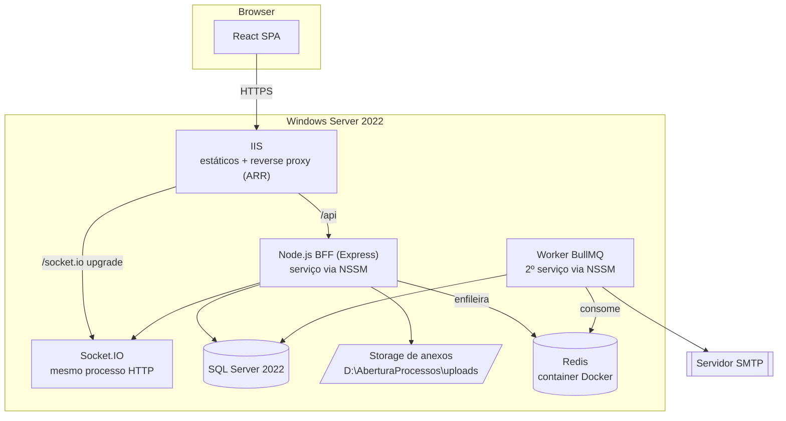
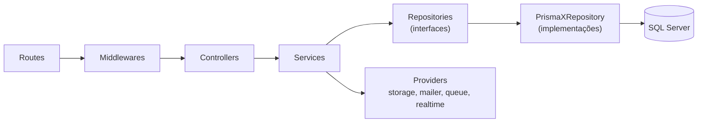
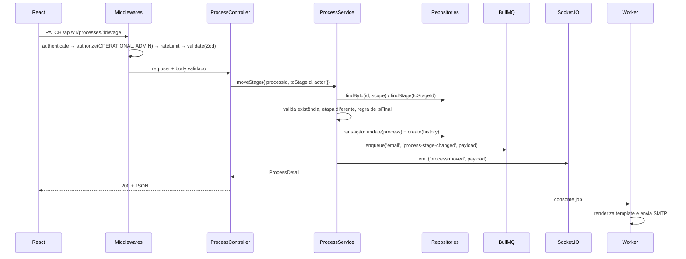

# 03 - Arquitetura

## Visão de implantação



O worker roda como processo separado do da API. Isso mantém o envio de e-mail isolado: uma queda do
SMTP ou um pico de jobs não afeta a latência da API, e o worker pode ser reiniciado sozinho.

## Camadas do backend



Responsabilidade de cada camada:

| Camada | Faz | Não faz |
| --- | --- | --- |
| **Routes** | Declara path, método, middlewares e aponta para o método do controller. | Regra de negócio, acesso a dados. |
| **Middlewares** | Autenticação, autorização por papel, rate limit, validação Zod, upload, tratamento de erro. | Consultas de negócio. |
| **Controllers** | Traduz HTTP → chamada de service → HTTP. Extrai dados de `req`, define status e serializa a resposta. | Regra de negócio, acesso ao Prisma, `try/catch` de erro esperado (delega ao error handler). |
| **Services** | Toda a regra de negócio: validações de domínio, autorização a nível de recurso, orquestração, disparo de eventos e jobs. | Conhecer `req`/`res`, conhecer Prisma. |
| **Repositories** | Persistência. Interface no domínio, implementação Prisma na infra. Recebe o filtro de escopo já resolvido e o aplica em toda query. | Regra de negócio. |
| **Providers** | Integrações externas atrás de interface: storage de arquivo, e-mail, fila, realtime, hash de senha, JWT. | Regra de negócio. |

Regra central (Dependency Inversion): **service depende de interface, nunca de implementação**.
Nenhum arquivo em `services/` importa `PrismaClient`.

```ts
// domain/repositories/process-repository.ts
export interface ProcessRepository {
  create(data: CreateProcessData): Promise<Process>;
  findById(id: string, scope: AccessScope): Promise<Process | null>;
  findMany(filter: ProcessFilter, scope: AccessScope): Promise<Paginated<Process>>;
  update(id: string, data: UpdateProcessData): Promise<Process>;
  softDelete(id: string, deletedById: string): Promise<void>;
  countByStage(scope: AccessScope): Promise<Array<{ stageId: string; total: number }>>;
}
```

`AccessScope` é um objeto resolvido pelo middleware de autenticação e propagado até o repositório.
É o mecanismo que garante o RNF-01 — o isolamento não depende de o desenvolvedor lembrar de filtrar:

```ts
export type AccessScope =
  | { kind: 'ALL' }                              // OPERATIONAL, ADMIN
  | { kind: 'COMPANIES'; companyIds: string[] }; // CLIENT
```

## Injeção de dependência

Composição manual em um único ponto (`container.ts`). Sem decorators, sem reflect-metadata.

```ts
// src/container.ts
export function buildContainer(prisma: PrismaClient, config: AppConfig) {
  const processRepository = new PrismaProcessRepository(prisma);
  const historyRepository = new PrismaProcessHistoryRepository(prisma);
  const stageRepository = new PrismaKanbanStageRepository(prisma);

  const storage = new LocalDiskStorage(config.storage.root);
  const queue = new BullMqQueueProvider(config.redis);
  const realtime = new SocketIoRealtimeProvider();

  const processService = new ProcessService({
    processRepository,
    historyRepository,
    stageRepository,
    queue,
    realtime,
  });

  return {
    processController: new ProcessController(processService),
    // ...
  };
}
```

Nos testes, o service é instanciado com fakes que implementam as mesmas interfaces. Não é preciso
subir banco nem Redis para testar regra de negócio.

## Estrutura de pastas do backend

```
backend/
├── prisma/
│   ├── schema.prisma
│   ├── migrations/
│   └── seed.ts
├── src/
│   ├── config/
│   │   ├── env.ts                 # leitura + validação Zod das variáveis de ambiente
│   │   └── constants.ts
│   ├── domain/
│   │   ├── entities/              # tipos de domínio (independentes do Prisma)
│   │   ├── enums/                 # uniões de string: Role, UserStatus, HistoryAction...
│   │   ├── errors/                # AppError, NotFoundError, ForbiddenError, ConflictError...
│   │   └── repositories/          # interfaces de repositório
│   ├── infra/
│   │   ├── prisma/
│   │   │   ├── client.ts
│   │   │   └── repositories/      # implementações Prisma
│   │   ├── storage/
│   │   │   ├── storage-provider.ts
│   │   │   └── local-disk-storage.ts
│   │   ├── queue/
│   │   │   ├── queue-provider.ts
│   │   │   ├── bullmq-queue-provider.ts
│   │   │   └── queues.ts          # nomes e tipos de payload
│   │   ├── mail/
│   │   │   ├── mailer.ts
│   │   │   ├── nodemailer-mailer.ts
│   │   │   └── templates/
│   │   ├── realtime/
│   │   │   ├── realtime-provider.ts
│   │   │   └── socket-io-provider.ts
│   │   ├── security/
│   │   │   ├── password-hasher.ts # interface + BcryptPasswordHasher
│   │   │   └── token-service.ts   # interface + JwtTokenService
│   │   └── logger.ts
│   ├── http/
│   │   ├── app.ts                 # monta o Express
│   │   ├── server.ts              # bootstrap + graceful shutdown
│   │   ├── routes/
│   │   │   ├── index.ts
│   │   │   ├── auth.routes.ts
│   │   │   ├── organization.routes.ts
│   │   │   ├── company.routes.ts
│   │   │   ├── user.routes.ts
│   │   │   ├── stage.routes.ts
│   │   │   ├── process.routes.ts
│   │   │   ├── document.routes.ts
│   │   │   └── dashboard.routes.ts
│   │   ├── controllers/
│   │   ├── middlewares/
│   │   │   ├── authenticate.ts
│   │   │   ├── authorize.ts       # guard por papel
│   │   │   ├── validate.ts        # validação Zod de body/query/params
│   │   │   ├── rate-limit.ts
│   │   │   ├── upload.ts          # Multer
│   │   │   ├── request-context.ts # requestId + logger filho
│   │   │   └── error-handler.ts
│   │   ├── schemas/               # schemas Zod das requisições
│   │   └── presenters/            # entidade → DTO de resposta
│   ├── services/
│   ├── passport/                  # estratégias Google e Microsoft
│   ├── workers/
│   │   ├── index.ts               # entrypoint do processo worker
│   │   └── email.worker.ts
│   ├── container.ts
│   └── shared/
│       ├── result.ts
│       ├── pagination.ts
│       └── cnpj.ts
├── tests/
│   ├── unit/
│   ├── integration/
│   └── helpers/
├── .env.example
├── jest.config.ts
├── tsconfig.json
└── package.json
```

## Fluxo de uma requisição: mover processo de etapa



Pontos de projeto nesse fluxo:

1. A atualização do processo e a escrita do histórico ocorrem na **mesma transação** — nunca existe
   movimentação sem trilha.
2. O enfileiramento acontece **depois** do commit. Se o Redis estiver fora, a movimentação persiste
   e o erro é logado; a requisição não falha (RF-51).
3. O evento de socket também é emitido pós-commit, para que quem receber e refizer a busca já veja
   o dado novo.

## Tratamento de erros

Hierarquia única em `domain/errors`:

```ts
export class AppError extends Error {
  constructor(
    readonly code: string,        // 'PROCESS_NOT_FOUND'
    message: string,
    readonly status: number,      // 404
    readonly details?: unknown,
  ) { super(message); }
}
```

Services lançam `AppError`. O `error-handler` (último middleware) converte para o envelope de erro
padronizado do documento 05, loga com `requestId` e, para erros não previstos, responde
`500 INTERNAL_ERROR` sem expor stack trace ao cliente.

## Backend for Frontend

O papel de BFF se materializa em endpoints agregadores desenhados para as telas, não em CRUD
genérico espelhando tabelas:

- `GET /processes/board` devolve etapas + processos agrupados + contadores em uma chamada, evitando
  N+1 de rede no carregamento do Kanban.
- `GET /processes/:id` devolve processo + documentos + histórico + opções de responsáveis, o que a
  gaveta de detalhe precisa de uma vez.
- `GET /dashboard/metrics` devolve as métricas já agregadas e prontas para plotar.
- `GET /auth/me` devolve usuário + papel + permissões efetivas + CNPJs acessíveis, para a UI montar
  navegação e esconder ações.
