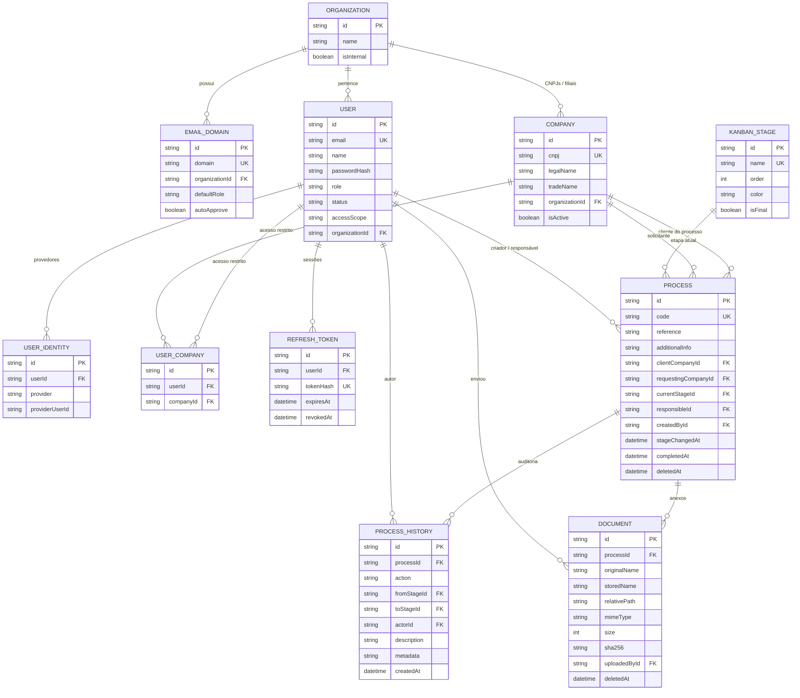

# 04 - Modelo de Dados

## Limitações do Prisma com SQL Server

Estas restrições foram verificadas e moldam o schema. Não são preferências de estilo.

| Limitação | Consequência no schema |
| --- | --- |
| O provider `sqlserver` **não suporta `enum`** ([prisma/prisma#6823](https://github.com/prisma/prisma/issues/6823)). | Papéis, status e ações de auditoria são `String` com comprimento fixo. Os valores válidos vivem em uniões de tipo TypeScript + schemas Zod, e são espelhados no banco por `CHECK constraint` adicionada via migration manual. |
| SQL Server aceita **apenas um `NULL`** por índice `UNIQUE`. | Não existe coluna anulável com `@unique`. IDs de provedores sociais foram movidos para `UserIdentity`, com unicidade composta `(provider, providerUserId)` e ambas as colunas obrigatórias. |
| `String` mapeia por padrão para `NVARCHAR(1000)` (2000 bytes), acima do limite de chave de índice do SQL Server (900/1700 bytes). | **Toda** coluna usada como PK, FK, `@unique` ou dentro de `@@index` recebe `@db.NVarChar(n)` explícito. |
| SQL Server rejeita **ciclos e múltiplos caminhos de cascade** ([regras especiais](https://www.prisma.io/docs/orm/v6/prisma-schema/data-model/relations/referential-actions/special-rules-for-referential-actions)). O default do Prisma para relação obrigatória é `onUpdate: Cascade`, que também entra nessa checagem. | `onDelete`/`onUpdate` são declarados explicitamente em **todas** as relações. Cascade existe só onde há um único caminho possível (filhos de `User` e de `Process`). O resto é `NoAction`. |
| Não há tipo `Json` nativo. | Campos de metadados são `NVARCHAR(MAX)` contendo JSON serializado pela aplicação. |

## Diagrama ER



## Valores de domínio (substitutos de enum)

`backend/src/domain/enums/index.ts`:

```ts
export const ROLES = ['CLIENT', 'OPERATIONAL', 'ADMIN'] as const;
export type Role = (typeof ROLES)[number];

export const USER_STATUSES = ['PENDING', 'ACTIVE', 'DISABLED', 'REJECTED'] as const;
export type UserStatus = (typeof USER_STATUSES)[number];

export const ACCESS_SCOPES = ['ORGANIZATION', 'COMPANIES'] as const;
export type AccessScopeKind = (typeof ACCESS_SCOPES)[number];

export const AUTH_PROVIDERS = ['LOCAL', 'GOOGLE', 'MICROSOFT'] as const;
export type AuthProvider = (typeof AUTH_PROVIDERS)[number];

export const HISTORY_ACTIONS = [
  'PROCESS_CREATED',
  'PROCESS_UPDATED',
  'STAGE_CHANGED',
  'RESPONSIBLE_CHANGED',
  'DOCUMENT_ADDED',
  'DOCUMENT_REMOVED',
  'PROCESS_DELETED',
] as const;
export type HistoryAction = (typeof HISTORY_ACTIONS)[number];
```

Esses arrays são a fonte única: alimentam os schemas Zod (`z.enum(ROLES)`), a tipagem do domínio e
as `CHECK constraints` no banco.

## Schema Prisma

`backend/prisma/schema.prisma`:

```prisma
generator client {
  provider = "prisma-client-js"
}

datasource db {
  provider = "sqlserver"
  url      = env("DATABASE_URL")
}

/// Grupo econômico. Fronteira de isolamento de dados.
model Organization {
  id         String   @id @default(cuid()) @db.NVarChar(30)
  name       String   @db.NVarChar(200)
  /// true = a própria trading (usuários OPERATIONAL/ADMIN)
  isInternal Boolean  @default(false)
  isActive   Boolean  @default(true)
  createdAt  DateTime @default(now())
  updatedAt  DateTime @updatedAt

  emailDomains EmailDomain[]
  companies    Company[]
  users        User[]

  @@index([name])
  @@map("organizations")
}

/// Domínio de e-mail que provisiona automaticamente usuários para a Organization.
model EmailDomain {
  id             String  @id @default(cuid()) @db.NVarChar(30)
  /// minúsculo, sem "@". ex.: "opusce.com.br"
  domain         String  @unique @db.NVarChar(255)
  organizationId String  @db.NVarChar(30)
  /// Role atribuída no provisionamento automático: CLIENT | OPERATIONAL | ADMIN
  defaultRole    String  @default("CLIENT") @db.NVarChar(20)
  /// true = usuário entra ACTIVE; false = entra PENDING mesmo com domínio reconhecido
  autoApprove    Boolean @default(true)
  createdAt      DateTime @default(now())

  organization Organization @relation(fields: [organizationId], references: [id], onDelete: Cascade, onUpdate: NoAction)

  @@index([organizationId])
  @@map("email_domains")
}

/// CNPJ (matriz ou filial).
model Company {
  id             String   @id @default(cuid()) @db.NVarChar(30)
  /// somente dígitos, 14 posições
  cnpj           String   @unique @db.NVarChar(14)
  legalName      String   @db.NVarChar(255)
  tradeName      String?  @db.NVarChar(255)
  organizationId String   @db.NVarChar(30)
  isActive       Boolean  @default(true)
  createdAt      DateTime @default(now())
  updatedAt      DateTime @updatedAt

  organization      Organization  @relation(fields: [organizationId], references: [id], onDelete: NoAction, onUpdate: NoAction)
  userAccesses      UserCompany[]
  clientProcesses    Process[]    @relation("ProcessClientCompany")
  requestedProcesses Process[]    @relation("ProcessRequestingCompany")

  @@index([organizationId])
  @@index([legalName])
  @@map("companies")
}

model User {
  id             String    @id @default(cuid()) @db.NVarChar(30)
  name           String    @db.NVarChar(200)
  email          String    @unique @db.NVarChar(255)
  /// null quando a conta existe apenas via provedor social
  passwordHash   String?   @db.NVarChar(255)
  /// CLIENT | OPERATIONAL | ADMIN
  role           String    @default("CLIENT") @db.NVarChar(20)
  /// PENDING | ACTIVE | DISABLED | REJECTED
  status         String    @default("PENDING") @db.NVarChar(20)
  /// ORGANIZATION = todos os CNPJs da org | COMPANIES = apenas os de UserCompany
  accessScope    String    @default("ORGANIZATION") @db.NVarChar(20)
  organizationId String?   @db.NVarChar(30)
  avatarUrl      String?   @db.NVarChar(1000)
  lastLoginAt    DateTime?
  approvedAt     DateTime?
  approvedById   String?   @db.NVarChar(30)
  createdAt      DateTime  @default(now())
  updatedAt      DateTime  @updatedAt

  organization Organization? @relation(fields: [organizationId], references: [id], onDelete: NoAction, onUpdate: NoAction)

  identities    UserIdentity[]
  companyAccess UserCompany[]
  refreshTokens RefreshToken[]

  createdProcesses     Process[]        @relation("ProcessCreatedBy")
  responsibleProcesses Process[]        @relation("ProcessResponsible")
  deletedProcesses     Process[]        @relation("ProcessDeletedBy")
  historyEntries       ProcessHistory[] @relation("HistoryActor")
  uploadedDocuments    Document[]       @relation("DocumentUploadedBy")
  deletedDocuments     Document[]       @relation("DocumentDeletedBy")

  @@index([organizationId])
  @@index([status])
  @@index([role])
  @@map("users")
}

/// Vínculo do usuário com um provedor de autenticação.
/// Existe para evitar coluna UNIQUE anulável (limitação do SQL Server).
model UserIdentity {
  id             String   @id @default(cuid()) @db.NVarChar(30)
  userId         String   @db.NVarChar(30)
  /// LOCAL | GOOGLE | MICROSOFT
  provider       String   @db.NVarChar(20)
  /// "sub" do provedor; para LOCAL usa-se o próprio e-mail
  providerUserId String   @db.NVarChar(255)
  createdAt      DateTime @default(now())

  user User @relation(fields: [userId], references: [id], onDelete: Cascade, onUpdate: NoAction)

  @@unique([provider, providerUserId])
  @@index([userId])
  @@map("user_identities")
}

/// Acesso explícito a um CNPJ. Só relevante quando accessScope = COMPANIES.
model UserCompany {
  id        String   @id @default(cuid()) @db.NVarChar(30)
  userId    String   @db.NVarChar(30)
  companyId String   @db.NVarChar(30)
  createdAt DateTime @default(now())

  user    User    @relation(fields: [userId], references: [id], onDelete: NoAction, onUpdate: NoAction)
  company Company @relation(fields: [companyId], references: [id], onDelete: NoAction, onUpdate: NoAction)

  @@unique([userId, companyId])
  @@index([companyId])
  @@map("user_companies")
}

/// Refresh token persistido por hash, para permitir revogação.
model RefreshToken {
  id        String    @id @default(cuid()) @db.NVarChar(30)
  userId    String    @db.NVarChar(30)
  /// SHA-256 do token; o valor puro nunca é gravado
  tokenHash String    @unique @db.NVarChar(64)
  expiresAt DateTime
  revokedAt DateTime?
  userAgent String?   @db.NVarChar(500)
  ipAddress String?   @db.NVarChar(64)
  createdAt DateTime  @default(now())

  user User @relation(fields: [userId], references: [id], onDelete: Cascade, onUpdate: NoAction)

  @@index([userId])
  @@index([expiresAt])
  @@map("refresh_tokens")
}

/// Etapa do funil. Global, ordenável, gerenciada por ADMIN.
model KanbanStage {
  id        String   @id @default(cuid()) @db.NVarChar(30)
  name      String   @unique @db.NVarChar(100)
  /// hex, ex.: "#1677ff"
  color     String   @default("#1677ff") @db.NVarChar(9)
  order     Int
  /// true = etapa terminal; ao entrar, grava completedAt
  isFinal   Boolean  @default(false)
  createdAt DateTime @default(now())
  updatedAt DateTime @updatedAt

  processes       Process[]        @relation("ProcessCurrentStage")
  historyFrom     ProcessHistory[] @relation("HistoryFromStage")
  historyTo       ProcessHistory[] @relation("HistoryToStage")

  @@index([order])
  @@map("kanban_stages")
}

/// Controle do código sequencial legível por ano (PRC-2026-00001).
model ProcessSequence {
  year       Int @id
  lastNumber Int @default(0)

  @@map("process_sequences")
}

model Process {
  id                  String    @id @default(cuid()) @db.NVarChar(30)
  /// PRC-{ano}-{5 dígitos}
  code                String    @unique @db.NVarChar(20)
  /// Referência informada no formulário
  reference           String    @db.NVarChar(255)
  /// Campo livre longo
  additionalInfo      String?   @db.NVarChar(Max)
  /// CNPJ para quem o processo é aberto
  clientCompanyId     String    @db.NVarChar(30)
  /// CNPJ que solicitou (modelo trading). null = igual ao clientCompanyId
  requestingCompanyId String?   @db.NVarChar(30)
  currentStageId      String    @db.NVarChar(30)
  responsibleId       String?   @db.NVarChar(30)
  createdById         String    @db.NVarChar(30)
  /// Quando entrou na etapa atual. Base do cálculo de tempo por etapa.
  stageChangedAt      DateTime  @default(now())
  completedAt         DateTime?
  deletedAt           DateTime?
  deletedById         String?   @db.NVarChar(30)
  createdAt           DateTime  @default(now())
  updatedAt           DateTime  @updatedAt

  clientCompany     Company     @relation("ProcessClientCompany", fields: [clientCompanyId], references: [id], onDelete: NoAction, onUpdate: NoAction)
  requestingCompany Company?    @relation("ProcessRequestingCompany", fields: [requestingCompanyId], references: [id], onDelete: NoAction, onUpdate: NoAction)
  currentStage      KanbanStage @relation("ProcessCurrentStage", fields: [currentStageId], references: [id], onDelete: NoAction, onUpdate: NoAction)
  responsible       User?       @relation("ProcessResponsible", fields: [responsibleId], references: [id], onDelete: NoAction, onUpdate: NoAction)
  createdBy         User        @relation("ProcessCreatedBy", fields: [createdById], references: [id], onDelete: NoAction, onUpdate: NoAction)
  deletedBy         User?       @relation("ProcessDeletedBy", fields: [deletedById], references: [id], onDelete: NoAction, onUpdate: NoAction)

  history   ProcessHistory[]
  documents Document[]

  @@index([currentStageId])
  @@index([clientCompanyId])
  @@index([requestingCompanyId])
  @@index([responsibleId])
  @@index([deletedAt])
  @@index([createdAt])
  @@map("processes")
}

/// Trilha de auditoria append-only.
model ProcessHistory {
  id          String   @id @default(cuid()) @db.NVarChar(30)
  processId   String   @db.NVarChar(30)
  /// PROCESS_CREATED | PROCESS_UPDATED | STAGE_CHANGED | RESPONSIBLE_CHANGED
  /// | DOCUMENT_ADDED | DOCUMENT_REMOVED | PROCESS_DELETED
  action      String   @db.NVarChar(30)
  fromStageId String?  @db.NVarChar(30)
  toStageId   String?  @db.NVarChar(30)
  actorId     String   @db.NVarChar(30)
  /// Frase pronta para exibição na timeline
  description String?  @db.NVarChar(1000)
  /// JSON serializado com o diff / detalhes
  metadata    String?  @db.NVarChar(Max)
  createdAt   DateTime @default(now())

  process   Process      @relation(fields: [processId], references: [id], onDelete: Cascade, onUpdate: NoAction)
  fromStage KanbanStage? @relation("HistoryFromStage", fields: [fromStageId], references: [id], onDelete: NoAction, onUpdate: NoAction)
  toStage   KanbanStage? @relation("HistoryToStage", fields: [toStageId], references: [id], onDelete: NoAction, onUpdate: NoAction)
  actor     User         @relation("HistoryActor", fields: [actorId], references: [id], onDelete: NoAction, onUpdate: NoAction)

  @@index([processId, createdAt])
  @@index([action])
  @@map("process_history")
}

model Document {
  id           String    @id @default(cuid()) @db.NVarChar(30)
  processId    String    @db.NVarChar(30)
  /// Nome enviado pelo usuário. Nunca usado como caminho físico.
  originalName String    @db.NVarChar(500)
  /// UUID + extensão. Nome real em disco.
  storedName   String    @db.NVarChar(255)
  /// Caminho relativo a STORAGE_ROOT, ex.: "2026/08/<processId>/<storedName>"
  relativePath String    @db.NVarChar(1000)
  mimeType     String    @db.NVarChar(255)
  /// bytes
  size         Int
  sha256       String    @db.NVarChar(64)
  uploadedById String    @db.NVarChar(30)
  deletedAt    DateTime?
  deletedById  String?   @db.NVarChar(30)
  createdAt    DateTime  @default(now())

  process    Process @relation(fields: [processId], references: [id], onDelete: Cascade, onUpdate: NoAction)
  uploadedBy User    @relation("DocumentUploadedBy", fields: [uploadedById], references: [id], onDelete: NoAction, onUpdate: NoAction)
  deletedBy  User?   @relation("DocumentDeletedBy", fields: [deletedById], references: [id], onDelete: NoAction, onUpdate: NoAction)

  @@index([processId, deletedAt])
  @@map("documents")
}
```

## CHECK constraints (migration manual)

Como não há enum, a integridade dos valores é garantida no banco por migration adicional. Criar com
`npx prisma migrate dev --create-only --name add_check_constraints` e escrever o SQL:

```sql
ALTER TABLE [users] ADD CONSTRAINT [CK_users_role]
  CHECK ([role] IN ('CLIENT','OPERATIONAL','ADMIN'));

ALTER TABLE [users] ADD CONSTRAINT [CK_users_status]
  CHECK ([status] IN ('PENDING','ACTIVE','DISABLED','REJECTED'));

ALTER TABLE [users] ADD CONSTRAINT [CK_users_access_scope]
  CHECK ([accessScope] IN ('ORGANIZATION','COMPANIES'));

ALTER TABLE [user_identities] ADD CONSTRAINT [CK_user_identities_provider]
  CHECK ([provider] IN ('LOCAL','GOOGLE','MICROSOFT'));

ALTER TABLE [email_domains] ADD CONSTRAINT [CK_email_domains_default_role]
  CHECK ([defaultRole] IN ('CLIENT','OPERATIONAL','ADMIN'));

ALTER TABLE [process_history] ADD CONSTRAINT [CK_process_history_action]
  CHECK ([action] IN ('PROCESS_CREATED','PROCESS_UPDATED','STAGE_CHANGED',
                      'RESPONSIBLE_CHANGED','DOCUMENT_ADDED','DOCUMENT_REMOVED',
                      'PROCESS_DELETED'));
```

Ao adicionar um valor novo em `domain/enums`, a constraint correspondente precisa ser atualizada por
nova migration. Um teste de integração deve percorrer os arrays de `enums` e conferir que todos os
valores são aceitos pelo banco, para que o esquecimento apareça na suíte e não em produção.

## Geração do código do processo

Dentro da mesma transação da criação do processo:

```ts
// 1) upsert + incremento atômico da sequência do ano
const year = new Date().getFullYear();
const [seq] = await tx.$queryRaw<{ lastNumber: number }[]>`
  MERGE [process_sequences] AS target
  USING (SELECT ${year} AS [year]) AS src ON target.[year] = src.[year]
  WHEN MATCHED THEN UPDATE SET target.[lastNumber] = target.[lastNumber] + 1
  WHEN NOT MATCHED THEN INSERT ([year], [lastNumber]) VALUES (src.[year], 1)
  OUTPUT inserted.[lastNumber] AS [lastNumber];
`;

// 2) PRC-2026-00001
const code = `PRC-${year}-${String(seq.lastNumber).padStart(5, '0')}`;
```

`MERGE` com `OUTPUT` resolve o incremento em uma única ida ao banco e sob a transação, evitando
código duplicado em criações concorrentes. O `@unique` em `code` é a rede de segurança: em caso de
colisão, o serviço tenta novamente (até 3 vezes) antes de falhar.

## Reordenação de etapas

`order` **não** é `UNIQUE`, justamente para permitir reordenar sem estados intermediários inválidos.
`PATCH /stages/reorder` recebe a lista completa de ids na ordem desejada e, em uma transação, grava
`order = índice`. A leitura sempre usa `orderBy: { order: 'asc' }, then { name: 'asc' }` para
resultado determinístico em caso de empate.

## Regras de exclusão

| Entidade | Estratégia |
| --- | --- |
| `Process` | Lógica: `deletedAt` + `deletedById` + histórico `PROCESS_DELETED`. Nunca `DELETE` físico. |
| `Document` | Lógica: `deletedAt` + `deletedById` + histórico `DOCUMENT_REMOVED`. Arquivo em disco é preservado. |
| `KanbanStage` | Física, bloqueada se houver processo ativo apontando para ela (RF-32). |
| `Company` / `Organization` | Nunca excluídas se houver processos ou usuários vinculados (FKs são `NoAction`; a API deve retornar `409 CONFLICT` com explicação em vez de deixar o erro do banco vazar). Preferir `isActive = false`. |
| `User` | Nunca excluído. `status = DISABLED` + revogação dos refresh tokens. Preserva a autoria no histórico. |

## Seed

`backend/prisma/seed.ts` cria o mínimo para o sistema funcionar:

1. `Organization` interna (nome via env, `isInternal = true`).
2. `EmailDomain` da trading (ex.: `opusce.com.br`) apontando para essa org, com
   `defaultRole = OPERATIONAL` e `autoApprove = true`.
3. Usuário ADMIN a partir de `ADMIN_SEED_EMAIL` / `ADMIN_SEED_PASSWORD`, `status = ACTIVE`, com
   `UserIdentity` `LOCAL`.
4. Etapas iniciais: `Entrada` (order 0), `Em Andamento` (order 1), `Concluído` (order 2,
   `isFinal = true`).
5. Sequência do ano corrente em `ProcessSequence`.

O seed é idempotente (usa `upsert` por chave natural) e pode rodar em produção na primeira subida.
Em ambiente de desenvolvimento, um passo extra opcional (`SEED_DEMO=true`) cria uma organização
cliente com dois CNPJs e alguns processos distribuídos entre as etapas, para exercitar o board e o
dashboard.
