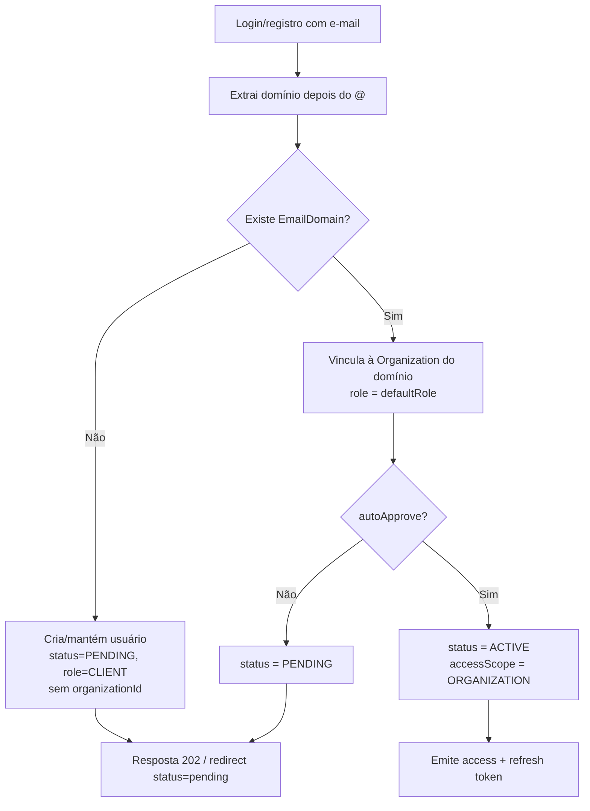

# 06 - Autenticação e Autorização

## Estratégia de tokens

| Token | Formato | Duração | Onde fica | Conteúdo |
| --- | --- | --- | --- | --- |
| Access | JWT HS256 | 15 min | Memória do front (nunca em `localStorage`) | `sub`, `role`, `organizationId`, `scope`, `iat`, `exp` |
| Refresh | String aleatória de 64 bytes (não é JWT) | 7 dias | Cookie `httpOnly` | Nada. É opaco; a validade vive na tabela `RefreshToken`. |

Payload do access token:

```json
{
  "sub": "cus3",
  "role": "CLIENT",
  "organizationId": "clo1",
  "scope": "ORGANIZATION",
  "iat": 1786000000,
  "exp": 1786000900
}
```

O token **não** carrega a lista de CNPJs. Ela é resolvida por requisição (com cache curto em
memória) para que mudanças de acesso feitas pelo ADMIN valham imediatamente, sem esperar a expiração
do token.

Cookie do refresh:

```
Set-Cookie: refreshToken=<opaco>; HttpOnly; Secure; SameSite=Lax; Path=/api/v1/auth; Max-Age=604800
```

`Path` restrito a `/api/v1/auth` reduz a superfície: o cookie só é enviado nas rotas que precisam
dele. `Secure` é ligado quando `COOKIE_SECURE=true` (obrigatório em produção).

### Rotação e detecção de reuso

`POST /auth/refresh` valida o hash do token, marca o registro atual como revogado e emite um novo
par. Se chegar um token já revogado e ainda não expirado, isso indica vazamento: todos os refresh
tokens do usuário são revogados, um log em nível `warn` é emitido com `userId` e IP, e a resposta é
`401 UNAUTHENTICATED`. O usuário precisa logar novamente.

Só o hash SHA-256 do token é persistido (`RefreshToken.tokenHash`). Um dump do banco não permite
sequestrar sessões.

## Senhas

- bcrypt com cost 12, atrás da interface `PasswordHasher`.
- Política mínima: 10 caracteres, com maiúscula, minúscula e dígito. Validada por Zod e reutilizada
  no front (mesmo schema).
- Comparação sempre por `bcrypt.compare`. Quando o e-mail não existe, executar um hash falso antes de
  responder, para que o tempo de resposta não revele a existência da conta.
- `passwordHash` nunca aparece em nenhum presenter. Os presenters montam o DTO campo a campo, em vez
  de espalhar a entidade (`...user`), justamente para impedir esse vazamento.

## Login social

### Google

`passport-google-oauth20`, scopes `profile` e `email`. Callback:
`{API_BASE_URL}/api/v1/auth/google/callback`.

### Microsoft

`passport-azure-ad` (estratégia OIDC) ou `passport-microsoft`, scopes `openid profile email`.
Callback: `{API_BASE_URL}/api/v1/auth/microsoft/callback`. `MICROSOFT_TENANT_ID=common` aceita
contas de qualquer tenant; usar o tenant específico se o acesso for restrito à organização.

### Regras comuns

1. O e-mail retornado pelo provedor precisa estar presente e verificado. Sem e-mail verificado →
   redireciona com `?status=error&code=EMAIL_NOT_VERIFIED`.
2. A resolução do usuário segue esta ordem:
   1. `UserIdentity` com `(provider, providerUserId)` → usuário já vinculado.
   2. `User` com o mesmo e-mail → cria uma nova `UserIdentity` vinculando o provedor à conta
      existente (atende RF-09: mesmo e-mail, múltiplos provedores).
   3. Nenhum dos dois → cria usuário novo aplicando o provisionamento por domínio.
3. Contas criadas por social ficam com `passwordHash = null`. Elas só ganham senha se o usuário
   definir uma depois (fora do escopo do v1).
4. `status = PENDING` bloqueia a emissão de token, inclusive no fluxo social.

## Provisionamento por domínio



Isso cobre as duas necessidades levantadas:

- **Carta branca por domínio** — `@opusce.com.br` com `defaultRole = OPERATIONAL` e
  `autoApprove = true` deixa a equipe interna entrar sem intervenção manual.
- **Domínio do cliente agrupando CNPJs** — `@clientex.com.br` aponta para a Organization "Cliente X",
  que tem os CNPJs da matriz e das filiais. O usuário entra vendo os processos de todos eles, e
  filial nova passa a aparecer sozinha.

Qualquer e-mail desconhecido (Gmail pessoal, por exemplo) cai na fila de pendentes. É o mecanismo que
atende ao requisito de "limitar quem pode abrir algo".

Normalização do domínio: `email.split('@')[1].trim().toLowerCase()`. A comparação é feita contra
`EmailDomain.domain` já gravado normalizado. Subdomínios **não** herdam o domínio pai — `x.opusce.com.br`
precisa de cadastro próprio (comportamento explícito para evitar liberação acidental).

## Middleware de autenticação

```ts
// http/middlewares/authenticate.ts
export function authenticate(deps: { tokenService: TokenService; scopeResolver: ScopeResolver }) {
  return async (req: Request, res: Response, next: NextFunction) => {
    const header = req.headers.authorization;
    if (!header?.startsWith('Bearer ')) {
      return next(new UnauthenticatedError());
    }

    const payload = deps.tokenService.verifyAccessToken(header.slice(7)); // lança em caso de erro
    const user = await deps.scopeResolver.load(payload.sub);              // status + escopo atual

    if (user.status === 'PENDING') throw new AppError('ACCOUNT_PENDING', '...', 403);
    if (user.status !== 'ACTIVE') throw new AppError('ACCOUNT_DISABLED', '...', 403);

    req.auth = {
      userId: user.id,
      role: user.role,
      organizationId: user.organizationId,
      scope: user.scope, // AccessScope: { kind: 'ALL' } | { kind: 'COMPANIES', companyIds }
    };
    next();
  };
}
```

O status é revalidado no banco a cada requisição (com cache em memória de 30 s por usuário). Assim,
desativar uma conta corta o acesso quase imediatamente, sem depender da expiração do access token.

### Resolução do escopo

```ts
async function resolveScope(user: UserRecord): Promise<AccessScope> {
  if (user.role === 'OPERATIONAL' || user.role === 'ADMIN') {
    return { kind: 'ALL' };
  }
  if (user.accessScope === 'COMPANIES') {
    return { kind: 'COMPANIES', companyIds: await repo.listCompanyIdsByUser(user.id) };
  }
  return {
    kind: 'COMPANIES',
    companyIds: await repo.listActiveCompanyIdsByOrganization(user.organizationId),
  };
}
```

Um CLIENT sem organização ou sem nenhum CNPJ resolvido recebe `companyIds: []`, o que resulta em
listas vazias e `404` em qualquer detalhe. Falha fechada, nunca aberta.

## Autorização

Duas camadas, ambas obrigatórias:

**1. Guard por papel (rota).** Barra o que o papel nunca pode fazer:

```ts
router.patch('/:id/stage',
  authenticate(deps),
  authorize('OPERATIONAL', 'ADMIN'),
  rateLimitByRole,
  validate({ params: idParamSchema, body: moveStageSchema }),
  controller.moveStage,
);
```

**2. Escopo por recurso (repositório).** Todo método de leitura recebe `AccessScope` e o traduz em
cláusula `where`:

```ts
function scopeWhere(scope: AccessScope): Prisma.ProcessWhereInput {
  if (scope.kind === 'ALL') return {};
  return {
    OR: [
      { clientCompanyId: { in: scope.companyIds } },
      { requestingCompanyId: { in: scope.companyIds } },
    ],
  };
}

// aplicado sempre junto com o filtro de exclusão lógica
const where: Prisma.ProcessWhereInput = { deletedAt: null, ...scopeWhere(scope), ...filters };
```

Como o escopo entra pela assinatura do repositório, esquecer de aplicá-lo é um erro de compilação, não
um bug silencioso de vazamento de dados.

Na escrita, o service valida explicitamente:

- Criar processo: `clientCompanyId` (e `requestingCompanyId`, se enviado) precisa estar em
  `scope.companyIds` quando o papel é CLIENT.
- Editar/anexar: carrega o processo com o escopo aplicado; se vier `null`, responde `404`.
- Excluir documento: CLIENT só pode excluir documento cujo `uploadedById` é ele mesmo.

### Mapa de permissões

`domain/permissions.ts` centraliza o mapa usado tanto pelos guards quanto pelo `permissions` de
`/auth/me` e do detalhe do processo. Uma única fonte evita divergência entre o que a UI mostra e o
que a API aceita.

```ts
export const PERMISSIONS_BY_ROLE = {
  CLIENT: ['process:create', 'process:read', 'process:update', 'document:create', 'document:read', 'document:delete:own'],
  OPERATIONAL: ['process:create', 'process:read', 'process:update', 'process:move', 'process:delete', 'process:assign', 'document:create', 'document:read', 'document:delete'],
  ADMIN: ['*'],
} as const satisfies Record<Role, readonly string[]>;
```

## Rate limiting

`express-rate-limit`. Em produção, com o IIS na frente, `app.set('trust proxy', 1)` é obrigatório —
sem isso todas as requisições contam como vindas do mesmo IP e o limite pune todo mundo junto.

| Escopo | Limite | Janela | Chave |
| --- | --- | --- | --- |
| `POST /auth/login`, `/auth/register` | 10 | 15 min | `IP + e-mail normalizado` |
| `POST /auth/refresh` | 60 | 15 min | IP |
| Callbacks OAuth | 30 | 15 min | IP |
| Requisições de CLIENT | 120 | 1 min | `userId` |
| Requisições de OPERATIONAL / ADMIN | 1000 | 1 min | `userId` |
| Uploads (`POST /processes/:id/documents`) | 30 | 10 min | `userId` |
| Fallback para não autenticado | 60 | 1 min | IP |

```ts
export const rateLimitByRole = (req: Request, res: Response, next: NextFunction) => {
  const role = req.auth?.role;
  if (role === 'ADMIN' || role === 'OPERATIONAL') return internalLimiter(req, res, next);
  if (role === 'CLIENT') return clientLimiter(req, res, next);
  return anonymousLimiter(req, res, next);
};
```

O limite interno é intencionalmente alto: serve apenas de rede de proteção contra um loop acidental
no front derrubar a aplicação, sem atrapalhar o trabalho da equipe (conforme definido).

Resposta ao estourar o limite: `429` com header `Retry-After` e o envelope de erro padrão
(`RATE_LIMIT_EXCEEDED`). O store padrão é em memória; se algum dia a API rodar em mais de uma
instância, trocar para `rate-limit-redis` aproveitando o Redis já presente.

## Outras proteções HTTP

```ts
app.set('trust proxy', 1);
app.use(helmet());                                  // CSP configurada à parte no IIS para o front
app.use(cors({ origin: config.cors.origins, credentials: true }));
app.use(express.json({ limit: '1mb' }));            // uploads não passam por aqui
app.use(cookieParser());
app.use(requestContext());                          // requestId + logger filho
```

- CORS com lista explícita de origens (`CORS_ORIGINS`), `credentials: true` para o cookie de refresh.
  Nunca `origin: '*'` junto com credenciais.
- Corpo JSON limitado a 1 MB; o limite de upload é do Multer, não do body parser.
- `?redirect=` nos fluxos OAuth é validado contra uma lista de caminhos internos permitidos.
- Em produção, o IIS termina o TLS e deve responder com HSTS.

## Checklist de segurança para revisão de PR

- [ ] Nenhum service importa `PrismaClient`.
- [ ] Todo método de leitura de processo/documento/histórico recebe e aplica `AccessScope`.
- [ ] Nenhum presenter espalha a entidade inteira (`...entity`) na resposta.
- [ ] Rotas novas declaram `authenticate` + `authorize` + `validate`.
- [ ] Nenhum log contém senha, token, cookie ou conteúdo de arquivo.
- [ ] Recurso fora do escopo responde `404`, não `403`.
- [ ] Caminho de arquivo derivado de entrada do usuário passa pela validação de `STORAGE_ROOT`.
