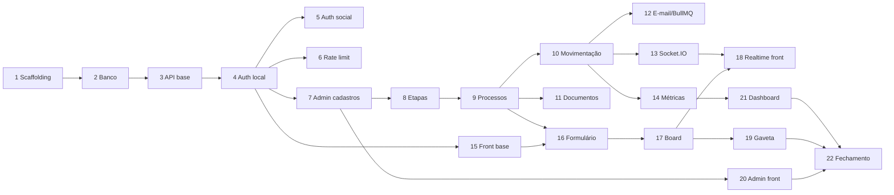

# 12 - Plano de Tarefas

22 tarefas incrementais. Cada uma entrega algo demonstrável e mantém o sistema funcionando ao final.
Executar em ordem: as dependências são sequenciais salvo indicação em contrário.

Legenda: **Refs** aponta os requisitos (documento 02) e os documentos com a especificação necessária.

---

## Fase 1 — Fundação

### Tarefa 1 — Scaffolding do monorepo

Criar `backend/` e `frontend/` na raiz. No backend: TypeScript strict, ESLint, Prettier, Jest,
`tsx` para desenvolvimento, estrutura de pastas vazia conforme documento 03. No frontend: Vite +
React + TS, ESLint com `react-hooks` e `jsx-a11y`, Prettier. `.gitignore`, `.editorconfig` e Husky +
lint-staged na raiz.

**Refs:** doc 03 (estrutura), doc 09 (tsconfig, ESLint), doc 10 (scripts).

**Aceite:** `npm run dev` no backend imprime log de inicialização; `npm run dev` no frontend abre a
página inicial em `:5173`; `npm run lint` e `npm run typecheck` passam nos dois; `npx husky` bloqueia
commit com erro de lint.

---

### Tarefa 2 — Infraestrutura local e banco

`docker-compose.yml` na raiz com SQL Server, Redis e Mailpit. Prisma configurado com
`provider = sqlserver`. `schema.prisma` completo (documento 04), primeira migration, migration manual
com as `CHECK constraints`, e `seed.ts` idempotente.

**Refs:** doc 04 (schema inteiro), doc 10 (docker-compose, env).

**Aceite:** `docker compose up -d` deixa os três containers saudáveis; `npx prisma migrate dev` cria
todas as tabelas sem erro de cascade ou de tamanho de índice; `npm run seed` cria org interna,
domínio, admin e as 3 etapas; `npx prisma studio` mostra os dados; rodar o seed duas vezes não
duplica nada.

> Ponto de atenção: erros de "multiple cascade paths" ou de tamanho de chave de índice aqui indicam
> `onDelete`/`onUpdate` ou `@db.NVarChar(n)` faltando. Ver a tabela de limitações no documento 04.

---

### Tarefa 3 — Esqueleto da API

`app.ts` com Helmet, CORS, `express.json`, cookie-parser, `requestContext` (requestId + Pino) e
`errorHandler`. `config/env.ts` validando as variáveis com Zod e abortando em caso de falha.
Hierarquia de erros em `domain/errors`. `container.ts` vazio, pronto para receber dependências.
`GET /health` e `GET /health/ready`.

**Refs:** doc 03 (camadas, erros), doc 05 (envelope de erro, health), doc 10 (validação de env).

**Aceite:** `GET /health` retorna 200; `GET /health/ready` retorna o estado de banco e Redis;
remover uma variável obrigatória do `.env` faz o processo abortar com mensagem clara; rota
inexistente responde no envelope de erro padrão com `requestId`; teste de integração com Supertest
cobrindo os três casos.

---

## Fase 2 — Identidade e acesso

### Tarefa 4 — Autenticação local e JWT

`PasswordHasher` (bcrypt) e `TokenService` (JWT) atrás de interface. `UserRepository` e
`RefreshTokenRepository`. `AuthService` com `register`, `login`, `refresh`, `logout` e `me`.
Middlewares `authenticate` e `authorize`. Rotação de refresh token com detecção de reuso. Resolução
de `AccessScope` por requisição.

**Refs:** RF-01 a RF-04, RF-09, RNF-01; doc 06 (tokens, middlewares, escopo), doc 05 (rotas de auth).

**Aceite:** login devolve access token e grava cookie httpOnly; `/auth/me` devolve usuário,
permissões e CNPJs; rota com `authorize('ADMIN')` responde 403 para CLIENT; refresh rotaciona e o
token antigo passa a falhar; reusar token revogado revoga a família e responde 401; testes unitários
de `AuthService` com fakes e integração dos fluxos.

---

### Tarefa 5 — Login social e provisionamento por domínio

Estratégias Passport para Google e Microsoft. `SocialAuthService` implementando a resolução em três
passos (identidade → e-mail → criação) e o provisionamento por domínio com `defaultRole` e
`autoApprove`. Redirect de callback para o front com `?status=`. `GET /auth/providers` informando
quais provedores estão configurados.

**Refs:** RF-02, RF-05, RF-06, RF-09; doc 06 (fluxo e diagrama), doc 10 (configuração dos provedores).

**Aceite:** com perfil mockado, domínio conhecido cria usuário `ACTIVE` na org correta com o papel do
domínio; domínio desconhecido cria `PENDING` sem token; e-mail já existente ganha `UserIdentity` nova
em vez de duplicar usuário; `autoApprove = false` força `PENDING` mesmo com domínio conhecido;
provedor sem credencial não quebra a subida da API.

---

### Tarefa 6 — Rate limiting

Limitadores por escopo: auth (IP + e-mail), refresh, callbacks OAuth, CLIENT, interno, upload e
fallback anônimo. `app.set('trust proxy', 1)`. Resposta 429 no envelope padrão com `Retry-After`.

**Refs:** RNF-02; doc 06 (tabela de limites).

**Aceite:** 11ª tentativa de login em 15 min responde 429 com `Retry-After`; CLIENT estoura em 120
req/min; ADMIN não é bloqueado no mesmo volume; teste de integração com o limitador configurado com
valores baixos por env.

---

### Tarefa 7 — Organizações, empresas e usuários (ADMIN)

CRUD de `Organization`, gestão de `EmailDomain`, CRUD de `Company` com validação de CNPJ (dígitos
verificadores), gestão de usuários: listar, filtrar pendentes, aprovar, rejeitar, atualizar, definir
`accessScope` e substituir o conjunto de `UserCompany`. `GET /users/operational`.

**Refs:** RF-07, RF-08, RF-10 a RF-14; doc 05 (rotas), doc 04 (regras de exclusão).

**Aceite:** admin cria org, adiciona domínio e dois CNPJs; aprova um usuário pendente e ele passa a
logar; domínio já usado por outra org responde 409; CNPJ inválido responde 400 `INVALID_CNPJ`;
excluir org/CNPJ com vínculos responde 409 com explicação; admin não consegue se rebaixar nem se
desativar; OPERATIONAL recebe 403 em todas essas rotas exceto `/users/operational`.

---

## Fase 3 — Domínio de processos

### Tarefa 8 — Etapas do Kanban

CRUD de `KanbanStage`, listagem ordenada com `?withCounts=true` e reordenação atômica por lista de
ids. Bloqueio de exclusão de etapa com processos ativos e da última etapa restante.

**Refs:** RF-30 a RF-33; doc 05 (rotas de stages), doc 04 (reordenação).

**Aceite:** criar etapa a coloca no fim da ordem; `PATCH /stages/reorder` persiste a nova ordem e a
listagem reflete; excluir etapa com processos responde 409 `STAGE_NOT_EMPTY` com `processCount`;
tentar excluir a última etapa responde 409; nome duplicado responde 409.

---

### Tarefa 9 — Criação e listagem de processos com escopo

`ProcessRepository` recebendo `AccessScope` em todo método de leitura. `ProcessService.create` com
geração do código sequencial (MERGE + OUTPUT na transação), posicionamento na primeira etapa e
histórico `PROCESS_CREATED`. `GET /processes` com filtros e paginação, `GET /processes/board`,
`GET /processes/:id` com `permissions` calculadas, `PATCH /processes/:id` com diff no histórico.

**Refs:** RF-20 a RF-24, RNF-01; doc 05 (payloads), doc 04 (código sequencial), doc 06 (escopo).

**Aceite:** criar processo devolve `PRC-{ano}-00001` e o próximo é `00002`; CLIENT vê apenas
processos dos seus CNPJs (validar com dois clientes de orgs diferentes); CLIENT alcança processo em
que sua empresa é apenas `requestingCompany`; detalhe de processo de outra org responde 404, não 403;
CLIENT não consegue criar processo para CNPJ fora do escopo; board devolve etapas com `total` e
processos limitados por `limitPerStage`; edição gera `PROCESS_UPDATED` com o diff.

---

### Tarefa 10 — Movimentação, responsável, exclusão e auditoria

`PATCH /processes/:id/stage` com atualização e histórico na mesma transação, `completedAt` conforme
`isFinal`, e `note` no metadata. `PATCH /processes/:id/responsible` restrito a usuários internos.
`DELETE /processes/:id` lógico com histórico. `GET /processes/:id/history` paginado.

**Refs:** RF-25 a RF-29; doc 05, doc 09 (padrão de service).

**Aceite:** mover gera `STAGE_CHANGED` com origem, destino, autor e timestamp; entrar em etapa final
grava `completedAt`, sair limpa; CLIENT recebe 403 ao mover; mover para a etapa atual responde 409;
atribuir CLIENT como responsável responde 400; processo excluído desaparece de listagem e board mas o
histórico permanece consultável; teste provando que falha na escrita do histórico desfaz a mudança de
etapa.

---

### Tarefa 11 — Documentos

`StorageProvider` (interface) + `LocalDiskStorage`. Multer com limite por `MAX_UPLOAD_SIZE_MB` e sem
filtro de tipo. Upload múltiplo, listagem, download com nome original, exclusão lógica. Nome físico
UUID, caminho `ano/mês/processId/`, hash SHA-256, validação de containment em `STORAGE_ROOT`.

**Refs:** RF-40 a RF-44, RNF-11; doc 05 (rotas), doc 04 (modelo `Document`).

**Aceite:** upload de arquivo sem extensão conhecida funciona; download devolve bytes idênticos e o
nome original (inclusive com acentos e espaços); arquivo acima do limite responde 413; nome com
`../` não escapa de `STORAGE_ROOT`; CLIENT de outra org recebe 404 no download; CLIENT só exclui o
que enviou; cada upload/exclusão gera histórico.

---

## Fase 4 — Assíncrono e agregação

### Tarefa 12 — Notificação por e-mail via BullMQ

`QueueProvider` + `BullMqQueueProvider`, `Mailer` + `NodemailerMailer`, worker `email` como processo
separado com `npm run dev:worker`. Job `process-stage-changed` disparado na movimentação, com
destinatários resolvidos no worker e envio por `bcc`. Job `user-pending-approval` avisando admins.

**Refs:** RF-50 a RF-52; doc 07 (filas, template, worker).

**Aceite:** mover processo faz o e-mail aparecer no Mailpit com assunto no formato definido e link
para o processo; lista de operacionais vazia encerra o job com `warn` sem erro; derrubar o Redis não
impede a movimentação (log `error` e resposta 200); job com SMTP falhando é retentado com backoff
crescente; `Ctrl+C` no worker espera o job corrente terminar.

---

### Tarefa 13 — Tempo real com Socket.IO

Gateway anexado ao servidor HTTP, handshake autenticado por access token, salas `role:internal` e
`company:<id>`, emissão pós-commit dos eventos `process:created`, `process:moved`, `process:updated`,
`process:deleted` e `stages:changed`.

**Refs:** RF-53, RF-54; doc 07 (salas, handshake), doc 05 (tabela de eventos).

**Aceite:** cliente sem token é rejeitado no handshake; dois clientes internos recebem `process:moved`
ao mover via API; cliente de outra org **não** recebe o evento; cliente cuja empresa é apenas
`requestingCompany` recebe; usuário com acesso aos dois CNPJs do processo recebe uma única vez.

---

### Tarefa 14 — Métricas do dashboard

`GET /dashboard/metrics` (ADMIN) com totais, contagem por etapa, por CNPJ, por organização, tempo
médio e mediano de conclusão, tempo médio por etapa derivado do histórico e série diária de
criados/concluídos. Filtro de período e de organização.

**Refs:** RF-60 a RF-63; doc 05 (formato da resposta).

**Aceite:** com dataset conhecido semeado, cada número é conferido no teste; `completionTime` bate
com o cálculo manual e traz `sampleSize`; a etapa atual de processo em aberto não entra em
`averageTimePerStage`; período sem dados retorna zeros e `sampleSize: 0` sem divisão por zero;
OPERATIONAL recebe 403.

---

## Fase 5 — Frontend

### Tarefa 15 — Scaffolding do front, rotas e login

Providers (QueryClient, ConfigProvider pt-BR, SocketProvider), `http-client` com interceptors e
refresh com fila, `auth-store` (Zustand sem persistência), bootstrap com refresh + `/auth/me`,
`RequireAuth` e `RequireRole`, `AppLayout` com navegação por papel, telas de login, cadastro, callback
OAuth e pendente, tradução de erros por `code`.

**Refs:** RF-01 a RF-06; doc 08 (rotas, cliente HTTP), doc 05 (auth).

**Aceite:** login local entra e cai em `/board`; F5 mantém a sessão sem piscar o login; login Google e
Microsoft completam o fluxo; conta pendente vai para `/pending` com mensagem adequada; CLIENT
acessando `/dashboard` é redirecionado; logout limpa a sessão e volta ao login; 401 em requisição
dispara um único refresh e repete a chamada.

---

### Tarefa 16 — Formulário de abertura

`/processes/new` com React Hook Form + Zod: seletor de CNPJ cliente com busca, solicitante opcional
atrás de toggle, referência, adicionais com contador e `Upload.Dragger` múltiplo. Submissão em dois
passos (processo, depois documentos) com tratamento de falha parcial.

**Refs:** RF-20, RF-40; doc 08 (tabela de campos e fluxo).

**Aceite:** enviar cria o processo, anexa os arquivos e exibe o código gerado; validação de campo
obrigatório aparece antes de qualquer chamada; CLIENT com um só CNPJ vem pré-selecionado; falha no
upload mantém o processo criado e informa quais anexos precisam ser reenviados; duplo clique no
submit não cria dois processos.

---

### Tarefa 17 — Board Kanban

`BoardPage` consumindo `/processes/board`, colunas na ordem das etapas com contador, `ProcessCard`
com código, referência, CNPJ, responsável, contagem de documentos e tempo na etapa. Drag-and-drop com
`@hello-pangea/dnd`, mutação otimista com rollback. Filtros persistidos na querystring.
"Carregar mais" por coluna.

**Refs:** RF-23, RF-25; doc 08 (board, mutação otimista).

**Aceite:** arrastar entre colunas persiste e sobrevive ao F5; erro do servidor devolve o card à
coluna original com mensagem; CLIENT não consegue arrastar (drag desabilitado) e não vê o botão de
mover; filtros ficam na URL e o link compartilhado reproduz a visão; navegação por teclado move um
card.

---

### Tarefa 18 — Tempo real no front

`SocketProvider` conectando com o access token, reconectando após refresh, e traduzindo eventos em
invalidação de queries. Indicador discreto de conexão perdida.

**Refs:** RF-53; doc 08 (tempo real), doc 07 (handshake).

**Aceite:** duas janelas logadas, mover card em uma reflete na outra sem reload; após expiração do
access token o socket reconecta com o token novo; queda de conexão mostra o indicador e a
reconexão volta a atualizar; o autor da ação não vê o card "piscar" (otimista converge com a
invalidação).

---

### Tarefa 19 — Gaveta de detalhe

`ProcessDrawer` com três abas: Dados (edição inline, responsável, mover etapa), Documentos
(uploader, lista, download via blob, exclusão) e Histórico (timeline com ícone por ação). Rota
`/processes/:id` abrindo a gaveta sobre o board.

**Refs:** RF-24, RF-26, RF-29, RF-42, RF-43; doc 08 (gaveta), doc 05 (detalhe).

**Aceite:** abrir card mostra dados, documentos e histórico; editar referência salva e aparece nova
entrada no histórico; anexar arquivo atualiza a lista e a contagem no card; download entrega o nome
original; ações desabilitadas conforme `permissions` do próprio processo; fechar a gaveta devolve o
foco ao card.

---

### Tarefa 20 — Visões por papel e administração

Telas de admin: organizações com painel de domínios, empresas com validação de CNPJ, usuários com
abas Pendentes/Todos e modal de aprovação, etapas com reordenação por drag-and-drop. Ajuste das
ações visíveis por papel em todas as telas via `<Can>`.

**Refs:** RF-07 a RF-14, RF-30 a RF-33; doc 08 (administração), doc 06 (mapa de permissões).

**Aceite:** logar como CLIENT, OPERATIONAL e ADMIN e confirmar que o menu e as ações correspondem à
matriz do documento 02; aprovar pendente pela UI habilita o login daquele usuário; reordenar etapas
por arrastar persiste; badge de pendentes reflete a contagem real.

---

### Tarefa 21 — Dashboard gerencial

`/dashboard` (ADMIN) com filtro de período e organização, cartões de totais e tempo médio de
conclusão, barras por etapa (cores das etapas), top 10 CNPJs, linha de criados vs. concluídos e
tabela de tempo médio por etapa com `sampleSize`.

**Refs:** RF-60 a RF-63; doc 08 (dashboard), doc 05 (métricas).

**Aceite:** números conferem com a API; trocar o período refaz a busca e atualiza tudo; período sem
dados mostra estado vazio em vez de gráfico quebrado; gráficos têm rótulo textual acessível além da
cor.

---

## Fase 6 — Fechamento

### Tarefa 22 — Suíte completa, README e verificação de deploy

Fechar os 14 fluxos de integração do documento 09, incluindo o teste de arquitetura e o de
consistência entre `domain/enums` e as `CHECK constraints`. Atingir os limites de cobertura. README
na raiz com setup local, arquitetura resumida e link para a documentação. Executar o checklist de
deploy do documento 11 em ambiente de homologação.

**Refs:** RNF-07, todos os anteriores; doc 09 (testes), doc 11 (deploy).

**Aceite:** `npm test` passa nos dois projetos e a cobertura atinge os limites configurados; o teste
de arquitetura falha se um service importar Prisma (verificar quebrando de propósito); uma pessoa que
nunca viu o projeto sobe o ambiente seguindo apenas o README; checklist pós-deploy do documento 11
completo, com o item de WebSocket confirmado na aba Network.

---
---

## Fase 7 — Alimentação por IA (e-mail → processo)

Contexto e decisões em `docs/13-integracao-ia-email.md`. A entrada de processos passa a ser feita
por um agente de IA que lê a caixa de e-mail da trading; o operacional segue usando o funil. A
Tarefa 27 veio da primeira execução real (volume da caixa e e-mails sem CNPJ).

### Tarefa 23 — Chaves de API (contas de serviço)

Model `ApiKey` (hash SHA-256, prefixo para exibição, usuário vinculado, `lastUsedAt`, `revokedAt`).
`ApiKeyService` com criar/listar/revogar. `authenticate` passa a aceitar `X-Api-Key` além do
`Bearer` JWT, populando o mesmo `req.auth` (mais `authKind` e `apiKeyId`). Rotas ADMIN
`POST/GET/DELETE /api-keys`. Tela de administração "Chaves de API" no front.

**Refs:** doc 13 (decisão 2), doc 06 (middleware), doc 05 (rotas de `/api-keys`).

**Aceite:** ADMIN cria chave para um usuário OPERATIONAL e recebe o segredo uma única vez;
`GET /processes` com `X-Api-Key` válida responde 200 e sem/errada responde 401; chave revogada
responde 401; usuário vinculado `DISABLED` responde 403; chave para usuário CLIENT é recusada com
400; `lastUsedAt` atualiza; testes unitários do service e do middleware e integração das rotas.

---

### Tarefa 24 — Origem, solicitante, data de recebimento e CPF

`Process` ganha `source` (`WEB` | `EMAIL` | `API`), `requesterName`, `requesterEmail`,
`receivedAt`; `Document` ganha `source` e `receivedAt`; `Company` ganha `documentType`
(`CNPJ` | `CPF`) e aceita CPF com validação de dígitos. Migration com as `CHECK constraints` novas.
`source` é derivado da autenticação (JWT → `WEB`, chave de API → `API`), nunca do payload.
Presenters e front (gaveta, lista de documentos, cadastro de empresa) refletem os campos.

**Refs:** doc 13 (decisão 7), doc 04 (schema), doc 05 (payloads).

**Aceite:** processo criado pelo formulário fica `source = WEB` e via chave de API `source = API`;
detalhe do processo devolve solicitante e `receivedAt`; documento devolve `receivedAt`; cadastro de
empresa aceita CPF válido, recusa CPF inválido com `400 INVALID_CPF` e continua recusando CNPJ
inválido; teste de consistência enum/CHECK cobre os arrays novos.

---

### Tarefa 25 — Intake por e-mail (idempotente)

Model `IntakeEvent` (único por `channel + externalId`, status `PROCESSING/COMPLETED/FAILED`).
`IntakeService` com claim/retomada (doc 13, decisão 4), resolução de empresa com cadastro
automático de `Company`/`Organization`/`EmailDomain` (decisão 5) e resolução de processo por
código/referência com desempate e candidatos (decisão 6). `MailAttachmentProvider` no domínio com
implementação Microsoft Graph (client credentials) em `infra/graph/`. Rotas `/intake/*` aceitando
JSON ou multipart (`payload` + `files`).

**Refs:** doc 13 (decisões 3 a 6), doc 05 (seção "Intake"), doc 10 (`GRAPH_*`).

**Aceite:** e-mail com CNPJ desconhecido cria organização, empresa e processo com documentos
(`source = EMAIL`, `receivedAt` do e-mail) e lista tudo em `warnings`/`created`; segunda chamada
com o mesmo `externalId` responde 200 `duplicate: true` sem criar nada; "Processo <ref>" anexa ao
processo certo, ambíguo responde 409 com candidatos e inexistente 404 com candidatos;
`fetchAttachments` com Graph desligado responde 503; CLIENT recebe 403 em todo `/intake/*`;
unitários com fakes de Graph/ReceitaWS e integração dos endpoints sem rede.

---

### Tarefa 26 — MCP server e prompt do agente

Pacote `mcp-server/` (stdio, `@modelcontextprotocol/sdk`) com as ferramentas `lookup_process`,
`create_process_from_email`, `attach_to_process` e `get_intake_event`, configurado por
`AP_API_URL`/`AP_API_KEY`. `docs/prompts/agente-email-haiku.md` com o prompt operacional do agente
(classificação novo × complemento, extração de campos, tratamento de 404/409, marcação do e-mail).

**Refs:** doc 13 (decisão 8 e fluxo), doc 05 (seção "Intake").

**Aceite:** `npm run build` no `mcp-server/` gera o binário; `npx @modelcontextprotocol/inspector`
lista as quatro ferramentas; uma chamada de `create_process_from_email` contra a API local cria o
processo; o prompt cobre os três desfechos (criado, anexado, escalado).

---

### Tarefa 27 — Pasta de intake por cópia, cursor e empresa pelo domínio

Resultado da primeira execução real da rotina (doc 13, decisões 9 e 10). (a) A IA lê a caixa de
entrada direto, descarta remetentes bloqueados na listagem (lista no prompt) e sabe onde parou:
`GET`/`PUT /intake/cursor` (ponteiro gravado por canal, model `IntakeCursor`, só anda para a
frente; sem ponteiro, deduzido do último evento) e `POST /intake/events/skip` registrando
`IGNORED`/`ESCALATED` como `kind` de `IntakeEvent` para o que foi lido e não processado
(migration da CHECK constraint + índice `[channel, status, receivedAt]`); `GET /intake/events`
ganha filtro `kind`. Modelo da rotina: Haiku 4.5, sem teto de e-mails por execução. (b) `company.document` passa a ser opcional no intake: sem CNPJ, a empresa é
resolvida pelo **domínio** do remetente e, se não existir, nasce em **cadastro pendente**
(`companies.cnpj`/`documentType` anuláveis, índice único filtrado em migration manual);
`PATCH /companies/:id` aceita `cnpj` só para concluir a pendência; `GET /companies` filtra por
`pendingRegistration`; o front mostra "Cadastro pendente" e permite completar na edição. MCP ganha
`get_intake_cursor`, `advance_intake_cursor` e `skip_email`; o prompt da rotina pagina a caixa a
partir do cursor, grava o cursor a cada página, retenta `FAILED` e descarta remetentes bloqueados
sem ler.

**Refs:** doc 13 (decisões 9 e 10, "Remetentes bloqueados"), doc 05 (seções "Intake" e
"Empresas"), doc 04 ("Limitações"), `docs/prompts/rotina-intake-claude-max.md`.

**Aceite:** sem ponteiro gravado o cursor é deduzido do último evento `COMPLETED`/`FAILED`
(`PROCESSING` não conta); `PUT /intake/cursor` grava, passa a valer sobre os eventos e ignora valor
mais antigo (`advanced: false`); `FAILED` aparece em `status=FAILED` até ser concluído ou escalado;
skip de mensagem já processada responde `duplicate: true` sem alterar o evento; e-mail pulado pode ser processado depois (evento reaberto,
não duplicado); e-mail sem CNPJ de domínio desconhecido cria organização + domínio + empresa
pendente e o processo; segundo e-mail do mesmo domínio reaproveita a pendente; e-mail posterior com
CNPJ conclui a pendente; duas pendentes coexistem e CNPJ duplicado continua rejeitado pelo índice;
`PATCH /companies/:id` com `cnpj` em empresa completa responde `409 COMPANY_DOCUMENT_LOCKED`;
webmail público sem CNPJ responde `400 COMPANY_REQUIRED`; `prisma migrate diff` contra o banco
migrado não acusa drift; `npm test` no MCP lista as oito ferramentas.

---

### Tarefa 28 — Caixa lida pelo servidor e documentos de qualquer parceiro

Resultado da primeira execução com Haiku (doc 13, decisões 9 e 11): a listagem pelo conector não
cabe numa execução, e a IA ignorava documentos vindos de terceiros. (a) `MailboxReader` no domínio
com implementação no mesmo provider Graph (`listMessages` na Inbox com `$filter`/`$orderby`,
`getMessage` com `Prefer: outlook.body-content-type="text"`); `GET /intake/mailbox/messages`
(`after`, `limit`, `exclude` aplicado no servidor; `listed`/`blocked`/`nextAfter`/`hasMore`) e
`GET /intake/mailbox/messages/:id` (corpo em texto sem histórico citado, `maxChars`, anexos sem
inline); erros `MAIL_READ_DISABLED`/`MAIL_UNAVAILABLE`. (b) `company.senderIsClient=false` resolve
o cliente pelo nome (empresa existente ou pendente sem domínio); `addReferences` em
`/intake/attachments` acrescenta identificadores à referência. MCP ganha `list_mailbox` e
`get_mailbox_message`; o prompt da rotina lê pela API, trata documento de qualquer remetente
externo como complemento (ou cria o processo) e não para enquanto `hasMore`.

**Refs:** doc 13 (decisões 9 e 11), doc 05 (seção "Intake": `/intake/mailbox/*`,
`senderIsClient`, `addReferences`), `docs/prompts/rotina-intake-claude-max.md`.

**Aceite:** listagem desde `after` descarta remetentes de `exclude` (e-mail ou nome, sem
maiúsculas) e devolve `nextAfter` da última listada mesmo bloqueada; detalhe corta o histórico
citado no primeiro marcador com texto antes, ignora marcador no início, trunca em `maxChars` e
omite anexos inline; Graph desligado responde 503 `MAIL_READ_DISABLED` e provedor fora, 503
`MAIL_UNAVAILABLE`; `senderIsClient=false` sem nome responde `COMPANY_REQUIRED`, com nome novo cria
organização + empresa pendentes sem `EmailDomain`, com nome existente usa a empresa;
`addReferences` acrescenta só o que falta, respeita 255 caracteres com aviso e gera
`PROCESS_UPDATED`; `npm test` no MCP lista as dez ferramentas.

---

### Tarefa 29 — Pasta por organização na caixa e tela "Intake IA" (sem relatório por e-mail)

Decisão 12 (doc 13). (a) `MailboxOrganizer` no domínio, implementado no provider Graph: acha/cria
`GRAPH_ORGANIZE_FOLDER/<Organização>` (cache de ids) e copia a mensagem
(`POST /messages/{id}/copy`); `IntakeService` chama depois de criar/complementar, best-effort
(403 → aviso "sem permissão", nunca erro); `GRAPH_ORGANIZE_ENABLED`/`GRAPH_ORGANIZE_FOLDER` no
env. (b) Front: página `/intake` (OPERATIONAL e ADMIN) listando `GET /intake/events` com
resultado, motivo, avisos, remetente, link para o processo, filtros e posição do cursor; item
"Intake IA" no menu. (c) Prompt da rotina sem conector e sem envio de e-mail. (d) Papel Exchange
passa a `Application Mail.ReadWrite`.

**Refs:** doc 13 (decisão 12 e "Configuração"), doc 10 (`GRAPH_ORGANIZE_*`), doc 08.

**Aceite:** ao criar e ao complementar, a cópia é pedida com `['Processos IA', '<Organização>']`;
`FORBIDDEN` vira aviso no resultado e no evento e o intake conclui; sem organizer nada é copiado
nem avisado; `sanitizeFolderName` remove `\ / : * ? " < > |` e limita a 100; o provider acha/cria
as pastas em ordem e reaproveita ids na segunda cópia; 403 → `FORBIDDEN`; a tela lista eventos
com filtros e o front compila sem erro.

## Ordem e paralelismo

A partir da tarefa 9, backend e frontend podem avançar em paralelo: 10–14 no backend e 15–17 no
front, desde que o contrato do documento 05 seja respeitado como fonte da verdade.

## Definition of Done (toda tarefa)

- [ ] `npm run typecheck` e `npm run lint` sem erro nos projetos tocados.
- [ ] Testes da tarefa escritos e passando; suíte completa sem regressão.
- [ ] Endpoint novo tem `authenticate` + `authorize` + `validate` e leitura com `AccessScope`.
- [ ] Contrato refletido no documento 05 antes do merge, se houver mudança.
- [ ] Checklist de segurança do documento 06 revisado.
- [ ] Nenhum segredo, `console.log` ou `any` introduzido.
- [ ] Critério de aceite da tarefa demonstrado de fato, não presumido.
