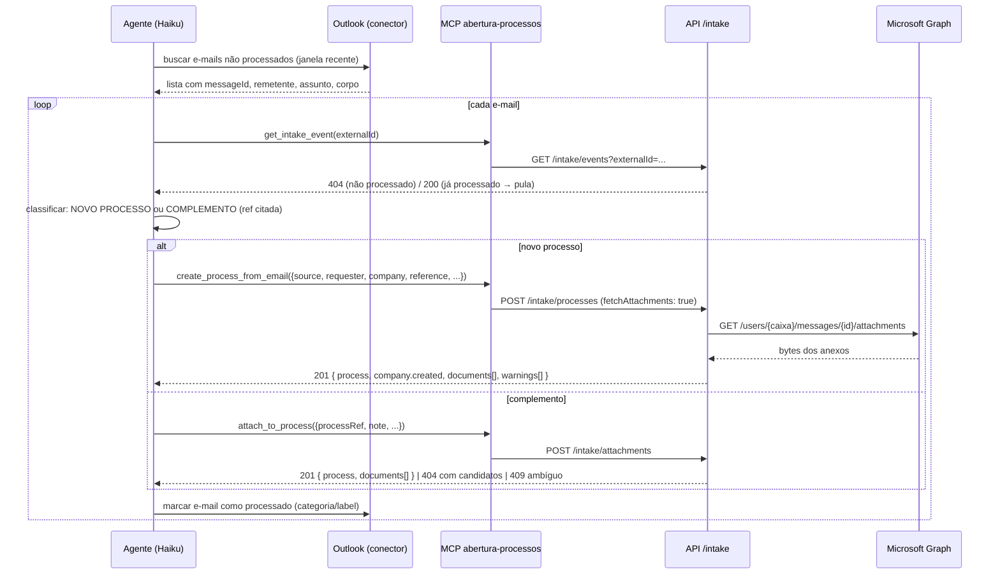

# 13 - Alimentação por IA (e-mail → processo)

## Objetivo

A entrada de processos e documentos deixa de ser feita por pessoas no formulário e passa a ser feita
por um **agente de IA** (Claude Haiku 4.5, em tarefa agendada, com o conector de Outlook) que lê a
caixa de e-mail da trading ao longo do dia. O operacional continua consultando e movimentando o
funil normalmente; o que muda é **quem alimenta** o sistema.

O agente precisa conseguir, com segurança e sem intervenção humana:

1. Abrir processo novo a partir de um e-mail: empresa (CNPJ ou CPF), solicitante (nome e e-mail),
   referência, informações adicionais, anexos e **data de recebimento** de cada informação.
2. Anexar documentos (e informações em texto) a um processo **já existente**, identificado pela
   referência ou pelo código que o cliente cita no e-mail ("Processo 123123, documento em anexo").
3. Repetir a leitura da mesma caixa quantas vezes for preciso **sem duplicar** nada.

## Decisões de arquitetura

### 1. O agente é um cliente da API, não parte dela

O agente não roda dentro do backend. Ele consome uma **API de intake** (`/intake/*`) desenhada para
máquina: idempotente, tolerante a cadastro faltando, com respostas que dizem explicitamente o que
foi feito e o que ficou pendente. Isso mantém as regras de negócio (escopo, auditoria, tempo real)
em um único lugar — o mesmo `ProcessService`/`DocumentService` que o formulário web usa — e permite
trocar o modelo, o orquestrador ou até o canal (WhatsApp, portal) sem tocar no domínio.

### 2. Autenticação por chave de API vinculada a um usuário interno

JWT de 15 minutos + refresh em cookie (docs/06) não serve para um processo agendado. O agente
autentica com o header `X-Api-Key`, cuja chave é:

- gerada por ADMIN em `POST /api-keys`, exibida **uma única vez** e persistida apenas por hash
  SHA-256 (mesmo tratamento do refresh token);
- **vinculada a um usuário interno** (OPERATIONAL ou ADMIN, ex.: "Agente de E-mail"). O agente age
  *como* esse usuário: `createdById`, `uploadedById` e `actorId` do histórico apontam para ele, então
  a timeline mostra "Agente de E-mail" como autor — auditoria preservada sem papel novo;
- revogável a qualquer momento (`DELETE /api-keys/:id`), com `lastUsedAt` para detectar chave morta.

O middleware `authenticate` aceita `X-Api-Key` **ou** `Authorization: Bearer <jwt>`; o restante da
cadeia (`authorize`, rate limit por usuário, `AccessScope`) não muda. Desativar o usuário vinculado
corta a chave imediatamente, pelo mesmo caminho que corta o JWT.

### 3. O agente nunca transporta bytes de anexo

Um modelo de linguagem não deve copiar megabytes de base64 de uma ferramenta para outra — é lento,
caro e falha silenciosamente. Por isso o intake aceita anexos de duas formas:

| Forma | Quando usar |
| --- | --- |
| `fetchAttachments: true` + `source.externalId` (id da mensagem no Microsoft Graph) | Padrão. **O backend baixa os anexos direto do Graph** com credenciais de aplicação (client credentials, `Mail.Read` restrito à caixa da trading). O agente só passa o id da mensagem que o conector de Outlook já devolveu. |
| `multipart/form-data` com `files[]` | Quando o orquestrador tem os arquivos em disco (ex.: um MCP de Outlook local que salva anexos). Mesmo `multer` do upload normal. |

As duas formas podem ser combinadas na mesma chamada. Sem `GRAPH_*` configurado,
`fetchAttachments: true` responde `503 MAIL_ATTACHMENTS_DISABLED` e o restante do intake funciona.

### 4. Idempotência por `externalId`, com "claim" antes do trabalho

Cada e-mail gera **um** `IntakeEvent`, único por `(channel, externalId)`. O fluxo é:

1. **Claim**: insere o evento como `PROCESSING`. Se já existe:
   - `COMPLETED` → responde `200` com o resultado gravado (`duplicate: true`), sem refazer nada;
   - `PROCESSING` → `409 INTAKE_IN_PROGRESS` (outra execução do agente está no meio);
   - `FAILED` → reaproveita o evento e **retoma**: se um processo já tinha sido criado antes da
     falha, anexa nele em vez de criar outro.
2. Faz o trabalho (baixa anexos → resolve empresa → cria/localiza processo → grava documentos e
   nota).
3. Marca `COMPLETED` com `processId`, `documentIds` e um resumo; em erro, marca `FAILED` com a
   mensagem e propaga o erro.

Assim, rodar o agente de novo sobre o mesmo e-mail (ou a mesma execução ser interrompida e refeita)
nunca duplica processo nem documento. Os anexos são baixados **antes** de criar o processo, para
que uma falha do Graph não deixe processo sem documento.

### 5. Empresa desconhecida é cadastrada, não rejeitada

O e-mail chega com um CNPJ/CPF que pode não estar cadastrado. Rejeitar travaria a alimentação e
exigiria um humano no caminho. A regra de resolução, em ordem:

1. Normaliza para dígitos. 14 dígitos → CNPJ, 11 → CPF; ambos validam dígito verificador
   (`400 INVALID_CNPJ` / `400 INVALID_CPF`).
2. `Company` existente pelo documento → usa. Inativa → `409 COMPANY_INACTIVE` (desativar foi uma
   decisão humana; o agente deve escalar em vez de contornar).
3. Não existe → resolve a **Organization**:
   - domínio do e-mail do solicitante cadastrado em `EmailDomain` → aquela organização;
   - senão, cria uma organização nova com o nome da empresa e, se o domínio **não** for de webmail
     público (gmail, hotmail, outlook, yahoo, etc.), cadastra o `EmailDomain` com
     `defaultRole = CLIENT` e **`autoApprove = false`** — agrupa as filiais que vierem depois sem
     conceder acesso automático a ninguém; quem logar por esse domínio entra `PENDING`.
4. Razão social: CNPJ → `CnpjLookupProvider` (ReceitaWS, docs/05) quando disponível; senão o nome
   informado pelo agente; senão o próprio documento formatado (com aviso em `warnings`).
5. Cria a `Company` com `documentType` (`CNPJ` | `CPF`).

Tudo que foi criado automaticamente vem listado na resposta (`company.created`,
`organization.created`, `warnings[]`), para o agente poder relatar e para o ADMIN revisar depois.

### 6. Resolução de processo por referência, com desempate e candidatos

"Processo 123123" pode ser o `code` (`PRC-2026-00042`) ou a `reference` que o cliente informou. A
ordem é: `code` exato (case-insensitive) → `reference` exata (case-insensitive, sem espaços
extras) → se houver mais de um, desempata pela organização do domínio do solicitante → ainda
ambíguo, `409 PROCESS_REF_AMBIGUOUS` com os candidatos → nenhum, `404 PROCESS_REF_NOT_FOUND` com
até 5 candidatos por busca parcial. O agente pode então decidir (ou perguntar ao operacional) e
chamar de novo com `processId` explícito, que pula a resolução.

### 7. Origem, solicitante e data de recebimento passam a fazer parte do domínio

`Process` ganha `source` (`WEB` | `EMAIL` | `API`), `requesterName`, `requesterEmail` e
`receivedAt`; `Document` ganha `source` e `receivedAt`. `source` é derivado da autenticação, nunca
informado pelo cliente: JWT → `WEB`, chave de API em rota comum → `API`, rota de intake → `EMAIL`.
A gaveta do processo mostra "Aberto por e-mail — João <joao@clientex.com.br>, recebido em
18/09/2026 10:32", e cada documento mostra sua data de recebimento.

### 8. Um MCP server próprio, fino, sobre a API

Para que o Haiku não precise montar `curl` com multipart, o repositório traz `mcp-server/`: um
servidor MCP (stdio) com quatro ferramentas — `lookup_process`, `create_process_from_email`,
`attach_to_process`, `get_intake_event` — que só traduzem chamada de ferramenta em requisição HTTP
com a chave de API. Zero regra de negócio ali. Se o orquestrador não suportar MCP local, a API
continua utilizável diretamente (docs/05).

## Fluxo de uma execução do agente



## Contrato resumido

Detalhe completo em `docs/05-contrato-api.md`, seção "Intake (alimentação por IA)". Resumo:

| Método | Rota | Papel | Descrição |
| --- | --- | --- | --- |
| `POST` | `/api-keys` | ADMIN | Cria chave vinculada a um usuário interno. Devolve o segredo **uma vez**. |
| `GET` | `/api-keys` | ADMIN | Lista (prefixo, usuário, `lastUsedAt`, `revokedAt`). |
| `DELETE` | `/api-keys/:id` | ADMIN | Revoga. |
| `GET` | `/intake/processes/lookup` | OPERATIONAL, ADMIN | Candidatos por `ref` (código/referência), `companyDocument`, `requesterEmail`. |
| `POST` | `/intake/processes` | OPERATIONAL, ADMIN | Abre processo a partir de um e-mail (JSON ou multipart com `payload` + `files`). |
| `POST` | `/intake/attachments` | OPERATIONAL, ADMIN | Anexa documentos/nota a processo existente por `processRef` ou `processId`. |
| `GET` | `/intake/events` | OPERATIONAL, ADMIN | Eventos de intake; filtro `externalId` para checar idempotência. |

## Configuração

Variáveis novas (docs/10): `GRAPH_INTAKE_ENABLED`, `GRAPH_TENANT_ID`, `GRAPH_CLIENT_ID`,
`GRAPH_CLIENT_SECRET`, `GRAPH_MAILBOX`, `GRAPH_TIMEOUT_MS`.

No Azure (Entra ID): registro de aplicação com permissão **de aplicação** `Mail.Read` (consentimento
de administrador) e, obrigatoriamente, uma `ApplicationAccessPolicy` do Exchange Online restringindo
a aplicação à caixa de entrada da trading — sem isso, `Mail.Read` de aplicação lê **todas** as caixas
do tenant:

```powershell
New-ApplicationAccessPolicy -AppId <GRAPH_CLIENT_ID> -PolicyScopeGroupId <caixa ou grupo> `
  -AccessRight RestrictAccess -Description "Intake de processos"
```

O agente em si é configurado pelo prompt em `docs/prompts/agente-email-haiku.md` e pelo MCP em
`mcp-server/README.md`.

## O que fica fora deste escopo

- Responder o cliente por e-mail (confirmação de abertura). O agente pode fazer isso com o próprio
  conector de Outlook, usando a resposta da API — não é responsabilidade do backend.
- Classificação do e-mail (novo × complemento × ruído). É trabalho do modelo, guiado pelo prompt; a
  API só oferece `lookup` para ele conferir antes de decidir.
- Fila assíncrona para o intake. O agente espera a resposta síncrona (segundos) e precisa dela para
  relatar; se um dia o volume exigir, `POST /intake/processes` pode passar a enfileirar e responder
  `202` com o `IntakeEvent` para consulta — o modelo de evento já comporta isso.
